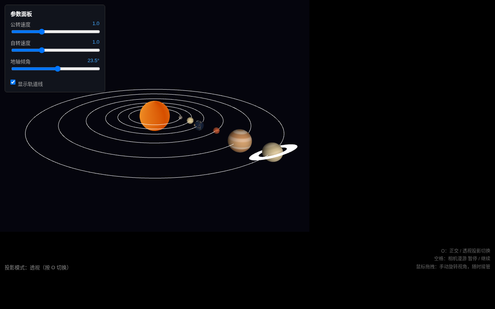
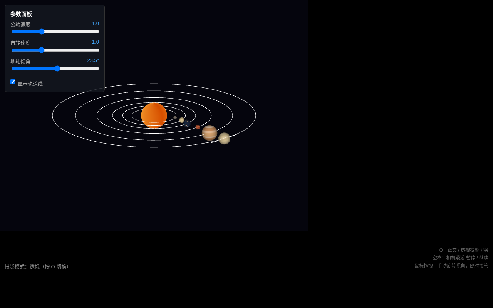

# AP2 三维层级场景：太阳系

基于原生 WebGL 2.0 实现的太阳系层级动画，对应教材 Ch4-5 几何变换与观察投影。

## 一、运行方式

项目为纯静态页面，无构建步骤。本地运行命令：

```bash
python3 -m http.server 8000
```

浏览器访问 http://localhost:8000/

线上地址：https://13051300305.github.io/ap2-solar-system/

## 二、文件结构

```
ap2-solar-system/
├── index.html              页面与着色器
├── Common/
│   ├── initShaders.js     着色器编译链接
│   ├── MV.js              矩阵与向量工具
│   └── webgl-utils.js     工具
├── js/
│   ├── sphere.js           球体网格与土星环网格
│   ├── planets.js          天体参数集中配置
│   ├── scene.js           层级模型矩阵
│   ├── camera.js          相机、投影、漫游
│   ├── interaction.js      鼠标、键盘、面板
│   └── main.js            渲染主循环
├── textures/              行星纹理图片
├── screenshot-perspective.png   透视投影截图
└── screenshot-orthographic.png  正交投影截图
```

## 三、层级结构图

模型矩阵按父子关系逐层相乘，形成如下嵌套树：

```
太阳
└── 地球
    └── 月球
水星（独立绕太阳）
金星（独立绕太阳）
火星（独立绕太阳）
木星（独立绕太阳）
土星（独立绕太阳 + 土星环）
```

地球模型矩阵的构造顺序：先缩放到地球半径，再自转，再施加 23.5° 轴倾角，再平移到公转轨道半径，最后绕太阳公转。这样轴倾角是在地球自身局部坐标系内先施加，再叠加公转轨道变换。

## 四、手动矩阵说明

月球轨道面相对地球公转面存在 5.1° 倾角。这一运动没有使用工具库封装好的复合函数，而是用 MV.js 的基本变换手工构造：

```
月球局部矩阵 =
  rotate(5.1°, Z轴)          // 先让轨道面整体倾斜
  × rotate(月球公转角, Y轴)   // 再让月球绕地球转动
  × translate(轨道半径)       // 再把月球放到轨道半径处
  × rotate(月球自转角, Y轴)   // 月球自转
  × scale(月球半径)

最终月球世界矩阵 = 地球矩阵 × 月球局部矩阵
```

通过这种手工 mult 链式组合，可以清楚看到变换顺序如何决定最终效果。

## 五、纹理与上下颠倒问题

太阳、地球、月球及各行星均使用位图纹理，通过 gl.texImage2D 上传。

普通 JPG 图片的像素坐标原点在左上角，而 WebGL 纹理坐标原点在左下角，直接采样会导致纹理上下颠倒。本项目在上传纹理前调用：

```javascript
gl.pixelStorei(gl.UNPACK_FLIP_Y_WEBGL, true);
```

这一行让 WebGL 在上传位图时自动翻转 Y 轴，从而显示出正向的地球。

## 六、双投影对比

按 O 键可在透视投影与正交投影之间切换。

透视投影近大远小，远处的轨道和行星在视野中收缩，符合人眼观察习惯。



正交投影下所有物体大小一致，平行线保持平行，没有近大远小，便于观察轨道几何关系。



## 七、交互说明

| 操作 | 功能 |
|---|---|
| 鼠标拖拽 | 手动旋转视角，随时接管 |
| 滚轮 | 缩放距离 |
| O 键 | 正交与透视投影切换 |
| 空格键 | 相机漫游暂停与继续 |
| 公转速度滑条 | 调整所有行星公转速度 |
| 自转速度滑条 | 调整所有天体自转速度 |
| 地轴倾角滑条 | 调整地球自转轴倾角 |
| 轨道线开关 | 显示或隐藏公转轨道 |

## 八、相机漫游

相机默认沿预设路径绕场景环绕一周，方位角随时间线性增长，仰角缓慢起伏。按空格可暂停或继续。任何时刻拖拽鼠标都会立即进入手动视角，之后再按空格可恢复漫游。

漫游录屏：AP2 太阳系.mp4，位于仓库根目录，时长约 10 秒。

## 九、选做扩展 E1

在必做的太阳、地球、月球之外，扩展为完整太阳系：

- 水星、金星、火星、木星、土星，共 6 颗行星
- 土星带有倾斜的光环
- 所有行星轨道线同时显示

所有天体参数集中在 js/planets.js 中，修改半径、轨道、速度即可调整场景。
